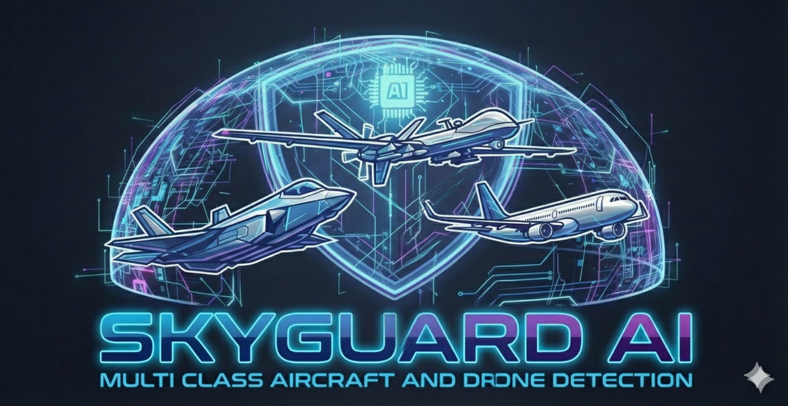
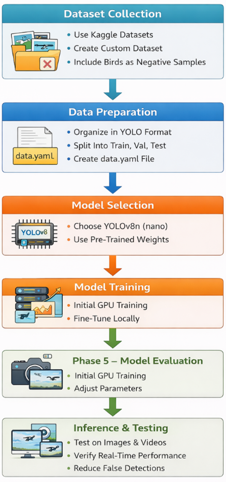
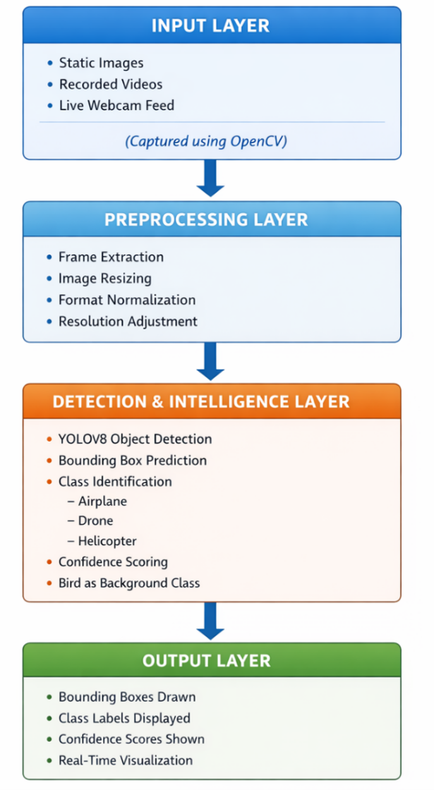
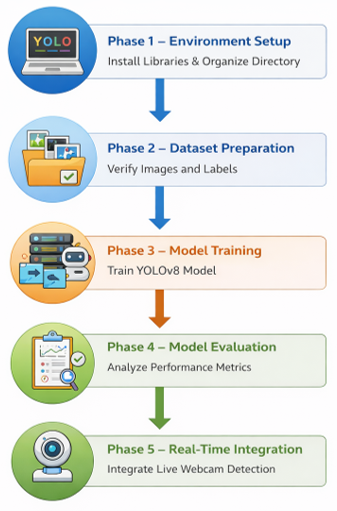
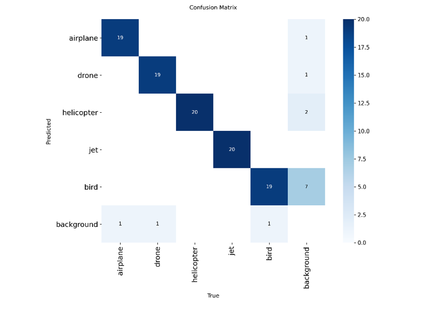
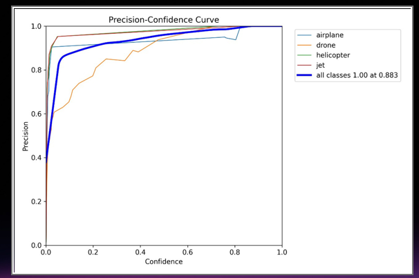
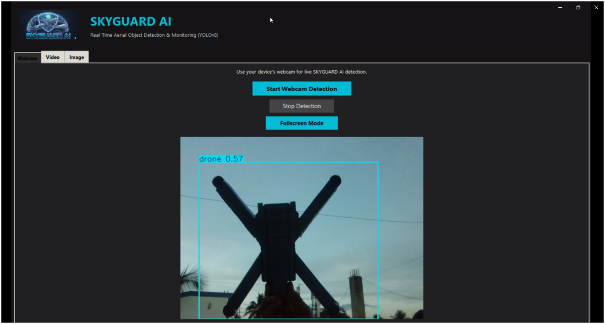
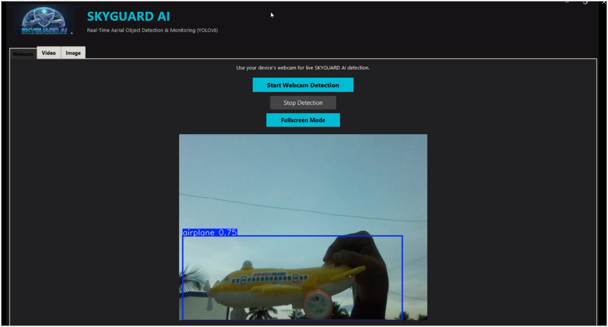
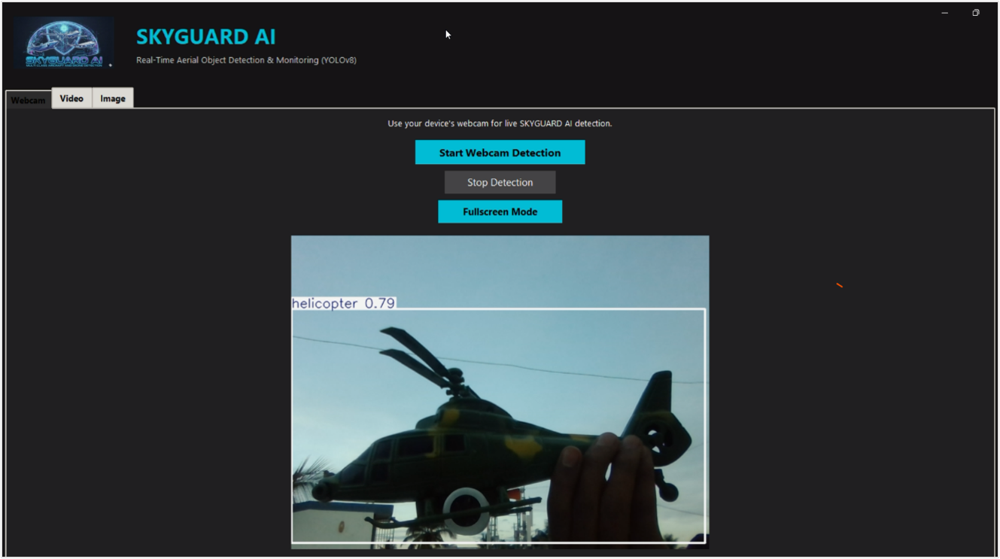

<p align="center">
  
</p>

<h1 align="center">🚀 SkyGuard AI</h1>

<h3 align="center">
Intelligent Aerial Object Recognition and Detection Using YOLOv8
</h3>

<p align="center">
  
  
  
  
  
  
</p>

<p align="center">
  <b>See the Sky. Detect the Unseen.</b>
</p>

---

# 📌 About the Project

**SkyGuard AI** is a computer vision project that uses the YOLOv8 object detection framework to identify and classify aerial objects in visual data. It processes images, recorded videos, and live webcam feeds to recognize different categories of flying objects.

The system is designed to detect five classes: **drones, aeroplanes, helicopters, jets, and birds**. By applying deep learning techniques to visual inputs, the application identifies objects and displays their predicted classes, bounding boxes, and confidence scores.

Developed as part of an AI internship, AEROVEX AI demonstrates the practical implementation of object detection, custom dataset preparation, transfer learning, and real-time inference. The project also explores how intelligent visual recognition can support aerial observation and aviation-monitoring applications.

---

# 🎯 Project Goals

* Build an object detection system capable of recognizing multiple aerial object categories.
* Apply YOLOv8 to image processing and real-time visual recognition.
* Develop a custom-labelled dataset for model training and evaluation.
* Explore the distinction between aircraft, drones, and naturally occurring flying objects.
* Visualize model predictions through bounding boxes and class-confidence scores.
* Establish a foundation for future aerial monitoring and intelligent surveillance applications.

---

# ✨ Key Capabilities

| Feature                     | Description                                             |
| --------------------------- | ------------------------------------------------------- |
| 🚁 Drone Recognition        | Detects drones appearing in supported visual inputs.    |
| ✈️ Aircraft Detection       | Identifies aeroplanes and jets.                         |
| 🚁 Helicopter Detection     | Recognizes helicopter instances in images and videos.   |
| 🐦 Bird Classification      | Includes birds as a separate detection category.        |
| 📷 Image Analysis           | Processes individual images for object recognition.     |
| 🎬 Video Analysis           | Runs object detection on recorded video footage.        |
| 🎥 Webcam Inference         | Supports live detection through a compatible webcam.    |
| 📦 Object Localization      | Displays bounding boxes around detected objects.        |
| 📊 Confidence Visualization | Presents model confidence scores alongside predictions. |
| ⚡ Deep Learning Inference   | Uses a trained YOLOv8 model for object detection.       |

---

# 🧠 Model and Technical Approach

AEROVEX AI uses a pretrained YOLOv8 model as the starting point for aerial object detection. Transfer learning allows the model to be adapted to the project's custom object categories.

| Component                  | Implementation                              |
| -------------------------- | ------------------------------------------- |
| Detection Architecture     | YOLOv8                                      |
| Model Framework            | Ultralytics                                 |
| Programming Language       | Python                                      |
| Image and Video Processing | OpenCV                                      |
| Numerical Operations       | NumPy                                       |
| Data Analysis              | Pandas                                      |
| Visualization              | Matplotlib                                  |
| User Interface             | Streamlit, if configured in the application |

---

# 📊 Dataset Development

A custom dataset was assembled to adapt the detection model to the project's target categories. Images from multiple sources were collected and organized for annotation, training, and evaluation.

## Target Categories

* ✈️ Aeroplane
* 🚁 Helicopter
* 🚁 Drone
* 🛩️ Jet
* 🐦 Bird

## Dataset Preparation

The dataset development process included:

* Collecting images representing the selected object categories.
* Incorporating images of toy aircraft and helicopters alongside other aerial imagery.
* Including bird images to help the model learn a distinct class for birds.
* Annotating objects using the YOLO bounding-box format.
* Organizing labelled data into training, validation, and testing subsets.

Including visually diverse examples helps expose the model to different object appearances. However, actual detection quality depends on dataset diversity, annotation consistency, training configuration, and evaluation results.

---

# 🏗️ System Architecture

The AEROVEX AI pipeline transforms raw visual input into annotated detection results through a sequence of processing stages.

### Architecture Overview

<p align="center">
  
</p>

**Pipeline components:**

1. **Input Acquisition:** Receives an image, video, or webcam stream.
2. **Image Preprocessing:** Prepares visual input for model inference.
3. **Object Detection:** Runs the trained YOLOv8 model to identify objects.
4. **Result Processing:** Interprets predicted classes, bounding boxes, and confidence scores.
5. **Output Visualization:** Displays the resulting detections to the user.

---

# 🔄 Development Workflow

The development workflow covers the main stages required to build and evaluate the aerial object detection system.

<p align="center">
  
</p>

The workflow begins with dataset collection and annotation, followed by dataset preparation, model training, validation, and testing. Once the model is trained, it can be integrated into the application for processing supported visual inputs.

---

# ⚙️ Methodology

The project follows a structured development methodology consisting of five major stages.

<p align="center">
  
</p>

**Phase 1 — Data Collection:** Gather images representing the required aerial object classes.

**Phase 2 — Data Annotation:** Label object locations and assign the appropriate class identifiers.

**Phase 3 — Model Training:** Adapt the pretrained YOLOv8 model using the prepared dataset.

**Phase 4 — Model Evaluation:** Assess detection performance using validation results and available evaluation metrics.

**Phase 5 — Application Integration:** Connect the trained model to the detection application for image, video, or webcam inference.

---

# 📈 Model Evaluation

Model evaluation helps measure how effectively the trained detector identifies and classifies objects across the selected categories.

## Confusion Matrix

<p align="center">
  
</p>

The confusion matrix provides insight into correct classifications and instances where the model confuses one class with another.

## Precision–Confidence Curve

<p align="center">
  
</p>

The precision–confidence curve illustrates how the model's precision changes as the confidence threshold varies.

*Note: Actual model performance should be reported using the metrics generated during training and evaluation. No specific accuracy value is assumed here.*

---

# 🎯 Detection Demonstrations

The following examples showcase the model's detection output for selected object categories.

## 🚁 Drone Detection

<p align="center">
  
</p>

Demonstrates the model's ability to locate and classify a drone in the provided visual input.

## ✈️ Aeroplane Detection

<p align="center">
  
</p>

Illustrates the predicted location and classification of an aeroplane.

## 🚁 Helicopter Detection

<p align="center">
  
</p>

Shows an example of helicopter recognition using the trained object detection model.

---

# 📂 Repository Structure

```text
aerovex-ai/
│
├── app.py
├── data.yaml
├── README.md
├── requirements.txt
├── .gitignore
│
├── assets/
│   ├── banner.png
│   ├── workflow.png
│   ├── architecture.png
│   ├── methodology.png
│   ├── confusion_matrix.png
│   ├── precision_curve.png
│   ├── drone_detection.png
│   ├── airplane_detection.png
│   └── helicopter_detection.png
│
├── notebooks/
│   └── drone.ipynb
│
├── dataset/        (Ignored in Git)
├── runs/           (Ignored in Git)
└── yolov8n.pt      (Ignored in Git)
```

*The structure above reflects the existing project layout. Rename the repository directory and update file paths only if you choose to reorganize the project.*

---

# 🚀 Getting Started

Follow these instructions to set up the project locally.

## Prerequisites

* Python installed on your system.
* pip package manager.
* A compatible environment for running the selected YOLOv8 model.
* A webcam if you intend to use live webcam detection.

## 1. Clone the Repository

```bash
git clone https://github.com/RayyanAhamed05/skyguard-ai-yolov8.git
cd skyguard-ai-yolov8
```

## 2. Install Dependencies

```bash
pip install -r requirements.txt
```

## 3. Launch the Application

```bash
python app.py
```

If the application uses Streamlit, launch it with:

```bash
streamlit run app.py
```

Use the command appropriate to the application's actual implementation.

---

# 🏋️ Training Overview

The model development process incorporates the following techniques:

* **Pretrained Model:** YOLOv8n as the initial model.
* **Transfer Learning:** Adapting pretrained weights to the custom dataset.
* **Custom Annotation:** Preparing labelled data in YOLO format.
* **Data Augmentation:** Applying supported transformations during training.
* **Validation:** Monitoring model behaviour on validation data.
* **Inference:** Testing detection on images, videos, or webcam streams.

Training settings and final performance values should be documented using the actual experiment configuration and output files.

---

# 🔮 Future Development

AEROVEX AI can be extended with additional capabilities as the project evolves.

* 🌙 Low-light and night-time object detection.
* 🌡️ Exploration of infrared imagery, subject to suitable data and hardware.
* 🎯 Multi-object tracking across consecutive video frames.
* 📡 Integration with compatible camera streams.
* ⚡ Edge-device deployment and inference optimization.
* 📊 Enhanced detection dashboards and result analytics.
* 🔔 Configurable alerts based on detection rules.
* ☁️ Cloud deployment for remote access and monitoring.

These are potential extensions rather than features claimed to be implemented in the current version.

---

# 👨‍💻 Project Author

**Mohammed Khaleel Khan**

Computer Science and Engineering
Artificial Intelligence | Machine Learning | Computer Vision

---

# 🙏 Acknowledgements

This project was developed during an AI internship as a practical exploration of deep learning and computer vision. The implementation builds on the YOLOv8 framework and demonstrates the process of preparing a custom dataset, training an object detection model, evaluating its outputs, and integrating detection capabilities into an application.

Special acknowledgement goes to the developers and contributors behind the open-source tools used in this project, particularly Ultralytics YOLO and OpenCV.

---

<p align="center">
  <b>AEROVEX AI — See the Sky. Detect the Unseen.</b>
</p>
